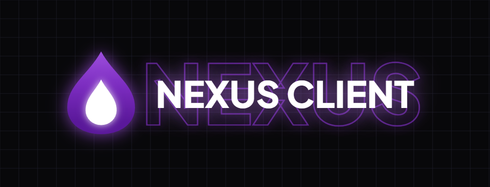

  

  # Nexus Client
  ### Nastepca DarkMC Launcher

  
  

  
  
  
  
  
  

  
  

## O Projekcie

Nexus Client jest tworzonym od podstaw oprogramowaniem do uruchamiania gry Minecraft, bedacym bezposrednim nastepca DarkMC Launcher. Celem projektu jest zapewnienie stabilnego dzialania, uporzadkowanego interfejsu oraz wsparcia dla aktualnych wersji gry i silnikow modyfikacji.

Projekt znajduje sie obecnie w fazie rozwoju. Trwaja prace nad podstawowymi modulami aplikacji oraz testy wewnetrzne.

## Zrzuty Ekranu (Wersja Beta)

### Pierwszy podglad interfejsu (Beta)

## Planowane Funkcje

- Obsluga wersji gry od 1.18.2 do najnowszych wydan.
- Wsparcie dla silnikow Forge oraz Fabric.
- Wbudowana obsluga i dostepnosc paczek modow.
- Obsluga autoryzacji kont Microsoft oraz trybu offline.
- Automatyczne dostosowywanie przydzialu pamieci RAM i parametrow srodowiska Java.
- Narzedzie ulatwiajace migracje profilow i ustawien z DarkMC Launcher.

---

## Spolecznosc

Informacje o postepach prac oraz zapowiedzi testow sa publikowane na serwerze Discord.

---

*Nexus Client – Zastepca DarkMC Launcher.*

