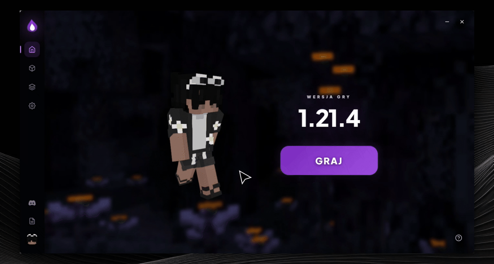

# Gdzie znaleźć formularz do wpisania propozycji w Nexus Client

Poradnik wyjaśnia, jak przesłać swój pomysł na nową funkcję lub ulepszenie programu Nexus Client za pomocą wbudowanego formularza.

## Instrukcja krok po kroku

1. **Przejście do ustawień**
Będąc na stronie głównej aplikacji Nexus Client, przejdź do zakładki **Ustawienia**.
2. **Otwarcie sekcji wsparcia**
Z menu ustawień wybierz opcję **Wsparcie**.
3. **Uruchomienie formularza**
Kliknij przycisk **Otwórz formularz**.
4. **Wybór typu zgłoszenia**
W otwartym oknie wybierz opcję **Zaproponuj zmianę**, opisz swój pomysł i prześlij formularz.

Gotowe! Twoja propozycja została przekazana twórcom launchera.

[[[Gdzie znaleźć formularz do wpisania propozycji w Nexus Client?,Jak przesłać pomysł na nową funkcję w Nexus Client?,Jaki typ zgłoszenia wybrać aby zaproponować zmianę w Nexus Client?]]]