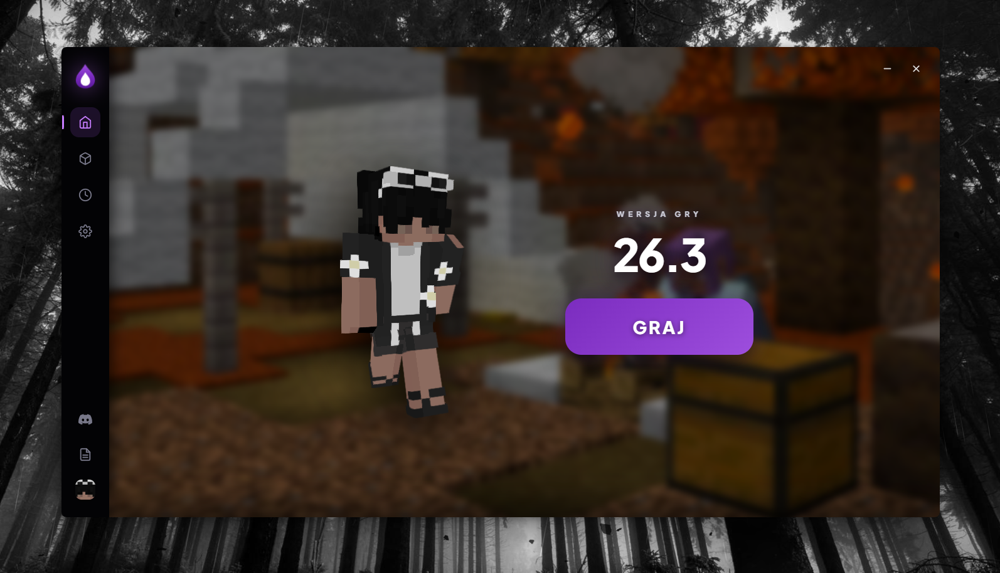

# Opis Wersji Beta – Nexus Client

---

Niniejszy dokument opisuje funkcje oraz moduły zawarte i działające w aktualnie udostępnionej wersji **Beta** aplikacji Nexus Client.

---

## Zrzut Ekranu Wersji Beta

---

## Funkcje Dostępne w Wersji Beta

### 1. Panel Logowania
- Obsługa trybu Offline (Non-Premium).
- Zapisywanie zapamiętanych sesji lokalnych.
- Szybkie przełączanie profili użytkownika.

### 2. Moduł Wyboru Wersji
- Wyświetlanie listy oficjalnych wersji Minecraft od 1.18.2 do najnowszych.
- Podstawowe przydzielanie parametrów pamięci RAM dla procesu gry.

### 3. Interfejs i Zarządzanie
- Ciemny motyw interfejsu dostosowany do nowej identyfikacji wizualnej Nexus Client.
- System powiadomień wbudowany w aplikację.
- Podgląd stanu połączenia z serwerami pomocniczymi.

---

## Zgłaszanie Błędów

Jeśli napotkasz błąd podczas korzystania z wersji Beta, zgłoś go na naszym serwerze Discord w odpowiednim kanale.

